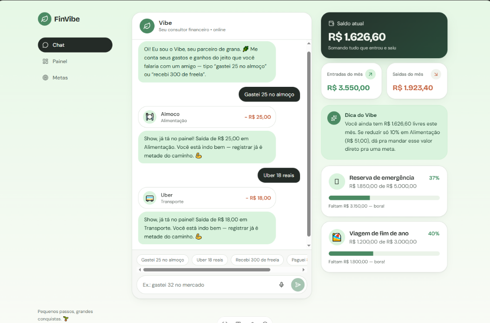
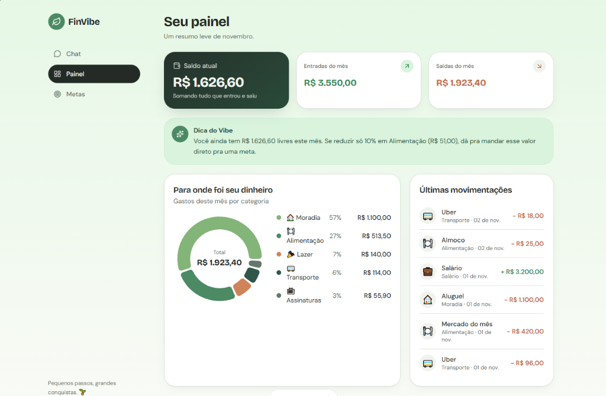
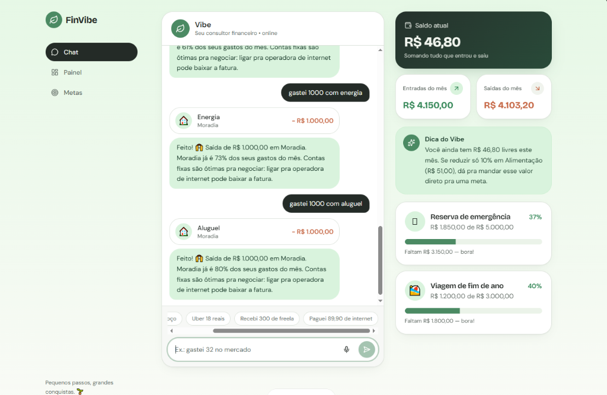

# 💸 FinVibe: App de Organização de Finanças Pessoais com Vibe Coding

> Projeto prático desenvolvido para o desafio da **DIO (Digital Innovation One)**: *App de Organização de Finanças Pessoais com Vibe Coding*.  
> Criado e prototipado através do conceito de **Vibe Coding**, utilizando prompts estruturados (PRD) e ferramentas de IA generativa (Lovable e Copilot).

---

## 📱 1. Resumo do Aplicativo: O que o FinVibe faz?

O **FinVibe** é um assistente financeiro pessoal conversacional projetado para eliminar o atrito, o tédio e a burocracia de preencher planilhas ou formulários extensos. 

Em vez de menus complicados, o usuário conversa com o **"Vibe"** — um consultor financeiro de inteligência artificial com tom de voz leve, empático e encorajador ("seu parceiro de grana"). Basta digitar ou falar em linguagem natural como se estivesse conversando com um amigo (ex.: *"gastei 25 no almoço"*, *"uber 18 reais"* ou *"recebi 300 de freela"*).

### ✨ Funcionalidades Principais:
- **Entrada Conversacional em Linguagem Natural:** O usuário registra entradas e saídas por texto ou voz via chat.
- **Categorização Automática Instantânea:** A IA interpreta o contexto e categoriza o gasto em tempo real (Alimentação, Transporte, Moradia, Lazer, etc.), criando o cartão da transação imediatamente.
- **Consultor Financeiro Inteligente ("Dica do Vibe"):** Análise proativa dos gastos em tempo real, alertando quando categorias de contas fixas concentram uma fatia excessiva do orçamento e sugerindo estratégias de economia.
- **Dashboard Financeiro Visual ("Seu Painel"):** Visão consolidada de Saldo Atual, Entradas e Saídas do Mês, gráfico de rosca com a distribuição percentual das despesas e histórico das últimas movimentações.
- **Gestão de Metas de Economia:** Acompanhamento dinâmico do progresso de metas (como *Reserva de Emergência* e *Viagem de fim de ano*) com barras de status e cálculo de valor restante.

---

## 📝 2. Prompt Final (PRD - Product Requirements Document)

Este foi o PRD estruturado que serviu como especificação (*briefing*) para guiar a IA na concepção e geração do aplicativo:

```markdown
# CONTEXTO
Você é um Arquiteto de Software e Product Designer especialista em Vibe Coding.
Quero construir um aplicativo web chamado "FinVibe", focado em organização e controle de finanças pessoais por meio de uma interface conversacional e amigável, eliminando atritos de entrada manual.

# PROBLEMA
Muitas pessoas abandonam o controle financeiro porque os aplicativos tradicionais exigem formulários manuais extensos e burocráticos. A entrada de dados é tediosa e não há suporte ativo ou motivação para a criação de hábitos saudáveis de economia.

# PÚBLICO-ALVO
Jovens adultos e iniciantes em educação financeira que buscam uma forma rápida, humana e sem complicação de organizar suas finanças diárias.

# ESCOPO FUNCIONAL DO MVP
1. **Chat Financeiro Interativo:**
   - Campo de entrada com atalhos de sugestão rápida ("Gastei 25 no almoço", "Uber 18 reais", "Recebi 300 de freela").
   - Suporte a comandos em linguagem natural e botão de áudio.
2. **Parser e Categorização Automática:**
   - Extração do valor, descrição, data e classificação automática em categorias (Alimentação, Transporte, Moradia, Lazer, Assinaturas, Salário).
3. **Agente Consultor ("Vibe"):**
   - Personalidade empática e motivadora.
   - Fornece feedback imediato de registro ("Show, já tá no painel!").
   - Emite alertas contextuais inteligentes (ex.: quando gastos com moradia ultrapassam limites saudáveis do orçamento).
4. **Painel de Controle (Dashboard):**
   - Cartões com Saldo Atual, Entradas do Mês e Saídas do Mês.
   - Gráfico de distribuição de gastos por categoria (donut chart).
   - Lista detalhada das últimas movimentações com valores e ícones.
5. **Módulo de Metas:**
   - Acompanhamento de metas financeiras com barra de progresso percentual e cálculo do valor faltante.

# REQUISITOS DE DESIGN E TOM DE VOZ
- Design limpo, acolhedor e minimalista, utilizando paleta em tons de verde suave, cinza grafite e branco ("vibe orgânica e tranquila").
- Responsivo e intuitivo (mobile-friendly).
- Tom de voz: parceiro de grana, encorajador, acessível, sem jargões bancários herméticos.
```

---

## 📸 3. Registros Visuais do Aplicativo (Interações com a IA)

Abaixo estão as capturas de tela do **FinVibe** gerado no Lovable a partir do PRD estruturado:

### 💬 Tela 1: Chat Conversacional & Registro Rápido
*O usuário informa os gastos cotidianos em linguagem natural e o consultor Vibe confirma o registro na hora, atualizando o saldo e as metas laterais.*



---

### 📊 Tela 2: Painel Geral (Dashboard & Gráfico de Despesas)
*Visão completa com resumo do mês, gráfico de distribuição de gastos por categoria (Moradia, Alimentação, Lazer, Transporte, Assinaturas) e histórico de transações.*



---

### 🧠 Tela 3: Consultoria Inteligente & Alertas Proativos do Agente
*Simulação de transações de alto valor (como aluguel e energia), demonstrando a capacidade do agente em alertar sobre a concentração de gastos e sugerir renegociações.*



---

## 💡 4. Reflexão sobre o Processo de Vibe Coding

### 🟢 O que funcionou bem?
- **Velocidade de ideação para execução:** A transição entre o PRD em texto e uma aplicação web visualmente rica e responsiva ocorreu em poucos minutos.
- **Fidelidade da Persona:** A IA conseguiu captar com precisão o tom de voz do consultor financeiro "Vibe", equilibrando empatia e profissionalismo nas mensagens de confirmação e nos alertas orçamentários.
- **Componentização e Layout:** Os cartões de saldo, as barras de metas com percentual dinâmico e o gráfico de rosca de categorias foram gerados perfeitamente integrados ao fluxo do chat.

### 🟡 O que não funcionou de primeira (e como foi ajustado)?
- **Foco Conversacional vs. Formulários:** Em primeiras iterações de teste, a IA sugeriu botões tradicionais de cadastro e modais complexos de transação. 
- **Ajuste:** Foi necessário reforçar no prompt que o *chat* era o canal primário e obrigatório de entrada de dados, e que botões seriam apenas "chips de atalho rápido" para agilizar mensagens comuns.
- **Cálculo de Proporção de Gastos:** Garantir que o agente contextualizasse os gastos (ex.: calcular que Moradia representava mais de 70% dos gastos totais e emitir a dica de negociação) exigiu instruir o comportamento do consultor como um nó de análise inteligente.

### 🚀 O que aprendi sobre conversar com IAs?
1. **O PRD é a bússola:** Em Vibe Coding, você não programa linha por linha, mas precisa pensar criticamente como Product Manager. A IA é tão boa quanto a clareza dos seus requisitos.
2. **Iteração por micro-ajustes:** Pedir uma tela base sólida e depois solicitar refinamentos específicos (ex.: *"adicione uma barra de progresso para a meta"* ou *"ajuste a paleta para tons de verde pastel"*) gera resultados muito superiores a prompts sobrecarregados.
3. **Autonomia criativa assistida:** A IA elimina o bloqueio técnico inicial, permitindo focar 100% na experiência do usuário, na proposta de valor e no design da solução.
